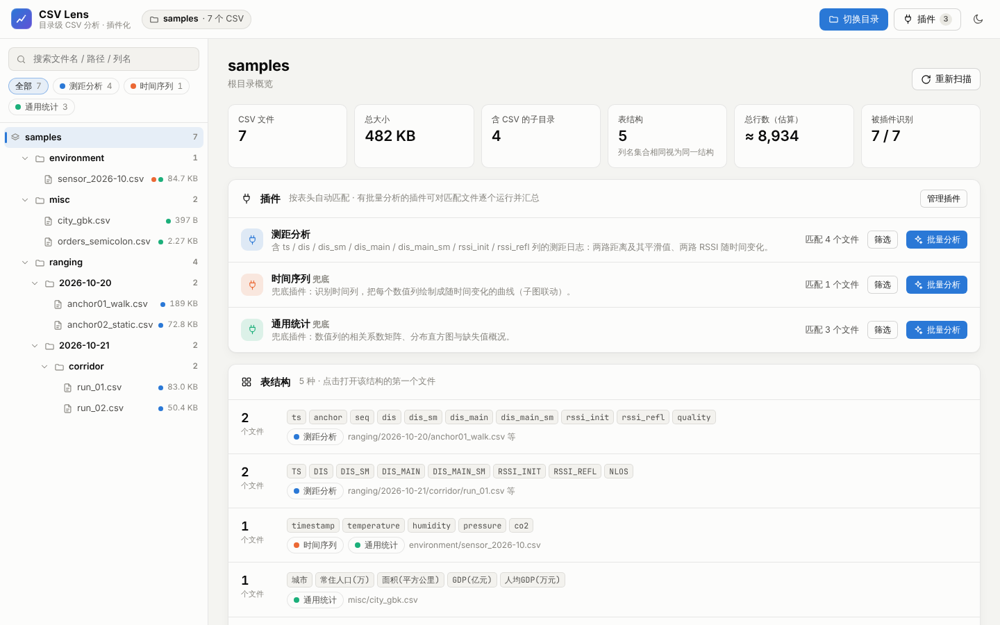
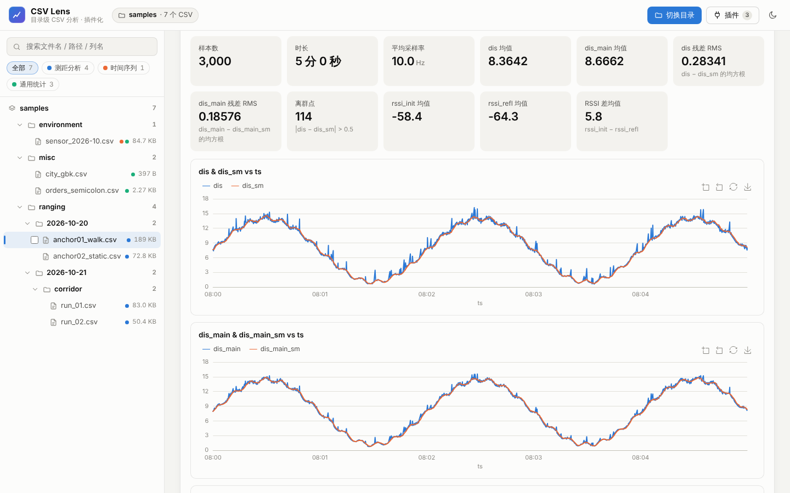

# CSV Lens · 目录级 CSV 分析工作台

一个**纯前端、单页面**的 CSV 分析工具：选择一个根目录，递归扫描其中（含所有子文件夹）的全部 `.csv / .tsv`，按表结构分组、统计列分布；
通过**插件**识别特定种类的 CSV，自动计算衍生特征、指标并绘制专属子图，还能对同类文件批量汇总、跨文件对比。

数据只在本机处理，不会上传。两种用法功能完全相同：

- **网页版**：双击 `index.html`，不需要安装和服务器。
- **Windows 桌面版**：一个 `CSVLens.exe`（约 8 MB），双击即打开独立窗口，内置全部插件和示例数据，见[下文](#windows-桌面版exe)。




## 快速开始

1. 用 Chrome / Edge（推荐）或 Firefox、Safari 直接打开 `index.html`。
2. 点「打开文件夹」选择根目录，或把文件夹直接拖进窗口。仓库自带 `samples/` 示例目录可以直接试用。
3. 左侧是文件树（插件匹配的文件带彩色圆点），点目录看概览，点文件看分析。

> 离线可用：ECharts 已放在 `lib/` 中；若该文件缺失，会自动改用 CDN。

## Windows 桌面版（exe）

`CSVLens.exe` 把整个网页版（页面、内置插件、ECharts、示例数据）打包成一个文件，用系统自带的 WebView2（Edge 内核）显示在独立窗口中。

- **运行**：双击 `CSVLens.exe`。Windows 10 / 11 一般已自带 WebView2；若没有，程序会自动改用默认浏览器打开（关闭页面几分钟后程序自动退出）。
  首次运行未签名的 exe 时，SmartScreen 可能提示「Windows 已保护你的电脑」，点「更多信息 → 仍要运行」。
- **示例数据**：欢迎页点「加载示例数据」即可试用。
- **插件文件夹**：exe 同目录下的 `plugins\` 中的 `.js` 会在启动时自动加载，不需要登记清单。
  「插件」面板中点「打开文件夹」会创建该文件夹（附带插件模板 `_template.js`、内置插件源码副本 `_builtin\` 和说明），
  修改插件后点「重新加载插件文件夹」即可生效。同 id 的插件会覆盖内置版本。
- **本地数据**：设置、在页面中编写的插件保存在 `%LOCALAPPDATA%\CSVLens`。
- **命令行参数**：`-browser` 强制用浏览器打开 · `-debug` 启用右键菜单和开发者工具（F12，调试插件时有用） · `-port N` 指定本地端口（默认 47821）。

程序只在 `127.0.0.1` 上提供服务，拒绝其他主机名的请求，不会对外开放端口。

**自己构建**（需要 Go 1.24+，任何系统都能交叉编译出 Windows 版）：

```sh
sh scripts/build-exe.sh        # Linux / macOS / Git Bash → dist/CSVLens.exe
scripts\build-exe.bat          # Windows 命令行
```

仓库的 GitHub Actions（`.github/workflows/build-exe.yml`）也会自动构建，在 Actions 页面下载 `CSVLens-windows-amd64`。
修改图标：编辑 `cmd/csvlens/winres/icon.svg`，运行 `node cmd/csvlens/winres/render_icon.js` 和 `python3 cmd/csvlens/winres/make_syso.py`。

## 功能

| 视图 | 内容 |
|---|---|
| **目录概览** | 文件数、总大小、表结构数、总行数；插件匹配情况与「批量分析」；表结构分组；列出现频率；可排序的文件清单 |
| **插件分析** | 匹配到的每个插件一张卡片：可调参数、衍生特征、指标卡片、子图（同一插件里 X 轴相同的图联动缩放/悬停） |
| **列统计** | 每列的类型、有效值、缺失、最小/最大/均值/标准差、分布小图或高频值 |
| **数据表** | 虚拟滚动表格（衍生特征列浅色底），可「导出 CSV」带上衍生特征 |
| **自由绘图** | 任选图形、X 列、多个 Y 列即时作图；列名相同的文件共享同一组图表 |
| **多文件对比** | 在文件树勾选 2–8 个文件 → 叠加同一列，可让 X 轴从各自起点对齐，并列出统计 |

其他细节：

- 自动识别分隔符（`,` `\t` `;` `|`）、编码（UTF-8 / GBK）、无表头文件、日期字符串列、Unix 时间戳（秒/毫秒/微秒/纳秒，自动变成时间轴）。
- 大文件在 Web Worker 中解析，界面不卡顿（实测 50 MB / 100 万行约 3 秒）。
- 侧栏搜索同时匹配文件名、路径和**列名**；可按插件筛选文件。
- 明暗主题；快捷键 `J` / `K` 切换下一个 / 上一个文件，`/` 聚焦搜索。
- 图表：`Ctrl + 滚轮` 缩放、拖拽平移，右上角工具可框选缩放、还原、导出 PNG。

## 插件

### 插件从哪里加载

1. **随页面加载**：把 `xxx.js` 放进 `plugins/`，在 `plugins/index.js` 的列表里加一行。
2. **在页面中导入 / 编写**：「插件」面板 → 导入 `.js`（或直接把 `.js` 拖进窗口）/ 新建插件。代码保存在浏览器本地（localStorage），刷新后自动加载，可随时编辑、停用、删除。
   在没有插件匹配的文件上点「为此类文件创建插件」，会用该文件的列名生成模板。
3. **跟随数据目录**：数据目录中的 `*.plugin.js` 会被发现，点击「加载」后启用（不会自动执行）。

同一个 `id` 再次注册会覆盖旧版本，所以修改后重新保存即可热更新。

### 示例：测距插件（`plugins/ranging.js`）

CSV 中有 `ts`、`dis`、`dis_sm`、`dis_main`、`dis_main_sm`、`rssi_init`、`rssi_refl` 列时，
自动画出 dis & dis_sm vs ts、dis_main & dis_main_sm vs ts、rssi_init & rssi_refl vs ts（每张图两条线，时间轴联动）：

```js
CSVViewer.registerPlugin({
  id: 'ranging',
  name: '测距分析',
  match: {                                                // 列名不区分大小写
    columns: ['ts', 'dis', 'dis_sm', 'dis_main', 'dis_main_sm', 'rssi_init', 'rssi_refl'],
  },

  features: [                                             // 衍生特征 → 新列
    { name: 'dis_resid', label: '平滑残差', compute: (t) => t.map(['dis', 'dis_sm'], (a, b) => a - b) },
  ],

  metrics: (t, { utils: u }) => [                         // 指标卡片
    { label: '残差 RMS', value: u.rms(t.col('dis_resid')) },
  ],

  charts: () => [                                         // y 给多个列 = 一张图多条线
    { title: 'dis & dis_sm vs ts',           type: 'line', x: 'ts', y: ['dis', 'dis_sm'] },
    { title: 'dis_main & dis_main_sm vs ts', type: 'line', x: 'ts', y: ['dis_main', 'dis_main_sm'] },
    { title: 'rssi_init & rssi_refl vs ts',  type: 'line', x: 'ts', y: ['rssi_init', 'rssi_refl'] },
  ],

  summarize: (t, { utils: u }) => ({ rssi_init_mean: u.mean(t.col('rssi_init')) }),   // 批量：每个文件一行
});
```

完整版本（`plugins/ranging.js`）还包含两路平滑残差、RSSI 差、采样间隔、离群点、可调参数、rssi vs dis 散点、残差分布和跨文件汇总图。
插件要求这 7 列都存在；如果你的文件列名不同，改 `match` 和各处列名即可。`match.columns` 里可以写别名数组（如 `['dis_sm', 'dissm']`），在 `charts(t)` 里用 `t.find(['dis_sm', 'dissm'])` 取得实际列名。
仓库另外自带两个**兜底插件**：`timeseries.js`（任意带时间列的 CSV：每个数值列随时间的曲线）和 `generic-stats.js`（相关系数矩阵、分布直方图）。
写新插件可从 `plugins/_template.js` 开始，里面注释了所有字段。

### 插件 API

```js
CSVViewer.registerPlugin({
  id, name, version, description,   // id 必填且唯一
  priority: 0,                      // 多个插件匹配同一文件时，大的排前面
  fallback: false,                  // true = 兜底插件：只在没有其他（非兜底）插件匹配时启用
  collapsed: false,                 // 卡片默认是否折叠
  match,                            // 匹配规则（见下）
  params: [],                       // 可调参数（见下）
  features: [],                     // 衍生特征（见下）
  metrics(t, ctx)   { return [ { label, value, unit, digits, hint } ] },
  charts(t, ctx)    { return [ chartSpec, ... ] },
  render(el, t, ctx) { /* 自定义 DOM */ },
  summarize(t, ctx) { return { key: value, ... } },        // 批量：每个文件 → 一行
  aggregate(s, ctx) { return { metrics: [...], charts: [...] } },   // s = 所有行组成的表（含 file / path 列）
});
```

**match**：只读表头即可判断，非常快。

```js
match: {
  columns: ['ts', ['dis', 'distance']],   // 都必须存在；内层数组 = 任一别名
  anyColumns: ['a', 'b'],                 // 至少存在一个
  numericColumns: ['rssi'],               // 必须是数值列
  path: 'logs/**/*.csv',                  // 路径通配（不含 / 时匹配文件名），也可以是正则
  minColumns: 3,
  test: (info) => true,                   // 额外条件
}
// 或者直接写函数：match: (info) => info.has('ts') && info.isNumeric('dis')
// info：name path dir size columns numericColumns has() find() type() isNumeric()
```

**params**：`{ key, label, type: 'number' | 'select' | 'checkbox' | 'text', default, min, max, step, options }`，
在页面上修改后自动重算，钩子中通过 `ctx.params.key` 读取（select 的值是字符串）。

**features**：`{ name, label, description, compute(t, ctx) }`，`compute` 返回与行数等长的数组。
按插件优先级依次计算，后面的特征可以用前面的；新列可用于绘图、列统计、导出。

**chartSpec**：

| 字段 | 说明 |
|---|---|
| `type` | `line`（默认）· `area` · `step` · `scatter` · `bar` · `histogram` · `heatmap` |
| `x` / `y` | 列名或数组；`y` 可为多个列名（同一纵轴多条线）。省略 `x` 用行号 |
| `series` | 精细控制：`[{ name, x, y, type, color }]` |
| `title` `subtitle` `height` `span` | 标题、副标题、高度（px）、宽度（1 = 半宽，2 = 整行；折线默认整行） |
| `xType` | `auto`（默认，时间列自动用时间轴）· `time` · `value` · `category` |
| `xLabel` `yZero` `yMin` `yMax` | 轴标题、纵轴从 0 开始、纵轴范围 |
| `markLines` | `[{ y: 0, label }]` 或 `[{ x }]` 参考线 |
| `horizontal` `labels` | 横向条形图、在条形末端显示数值 |
| `bins` `range` | 直方图分箱数、范围 |
| `xCategories` `yCategories` `data` `min` `max` `diverging` | 热力图：`data` 为 `[[xi, yi, v], ...]` |
| `group` | 联动分组名；`false` 关闭联动（默认按 `x` 列自动分组） |
| `option` | 与生成的 ECharts option 深度合并（如 `{ series: [{ smooth: true }] }`） |
| `echarts` | 直接给出完整的 ECharts option（或返回 option 的函数） |

**数据表 `t`**：`rowCount` · `columns` · `numericColumns` · `col(name)`（数值列为 `Float64Array`，缺失为 `NaN`；列名不区分大小写）·
`has(...)` · `find(nameOrAliases)` · `type(name)` · `isNumeric(name)` · `map([cols], (a, b, i) => …)` · `stats(name)` · `row(i)` · `getColumn(name)`。
日期字符串列已转成毫秒时间戳（type 为 `datetime`）。

**`ctx`**：`params` · `utils` · `file`（`{ name, path, dir, size }`）· `theme`（当前主题色）· `h(tag, props, ...children)` · `renderChart(el, spec)` · `echarts`。

**`ctx.utils`**（也可以用 `CSVViewer.utils`）：
`count sum mean variance std min max extent rms median quantile` ·
`diff cumsum movingAverage(a, w, center) ema(a, alpha) zscore histogram(a, bins) corr(a, b) linreg(x, y)` ·
`duration(values, unit)`（返回 `{ seconds, text }`，unit 为 `auto | s | ms | us | ns`）· `timeColumn(t)` · `epochScale(values)` · `isTimeName(name)` ·
`fmt fmtDuration fmtDate fmtBytes`。

> 插件是普通 JavaScript，在页面中直接执行，请只加载你信任的代码。

## 目录结构

```
index.html              主程序（HTML + CSS + JS，单文件）
plugins/
  index.js              插件清单：列出随页面加载的插件
  ranging.js            测距分析（ts / dis / dis_sm / dis_main / dis_main_sm / rssi_init / rssi_refl）
  timeseries.js         时间序列（兜底）
  generic-stats.js      通用统计（兜底）
  _template.js          插件模板（带完整注释，不会自动加载）
samples/                示例数据（generate_samples.py 可重新生成）
lib/echarts.min.js      ECharts 5.6.0（Apache-2.0）
docs/                   截图
assets.go               桌面版：把上面的网页资源嵌入 exe
cmd/csvlens/            桌面版程序（Go）：本地服务 + WebView2 窗口
  winres/               图标源文件与资源生成脚本
scripts/build-exe.*     构建 dist/CSVLens.exe
```

## 说明

- 读取目录：Chrome / Edge 使用 File System Access API（支持「重新扫描」）；其他浏览器使用文件夹选择框或拖拽。
- 会跳过 `.git`、`node_modules`、`__pycache__` 等目录。
- 单个文件建议不超过约 200 MB（整个文件会读入内存）；数据表最多显示前 50 万行，统计和图表使用全部数据，折线图使用 LTTB 降采样。
